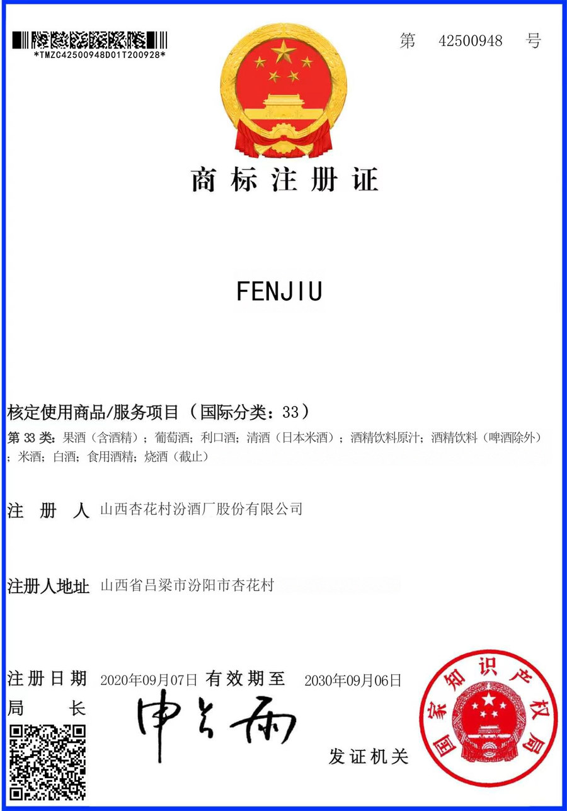
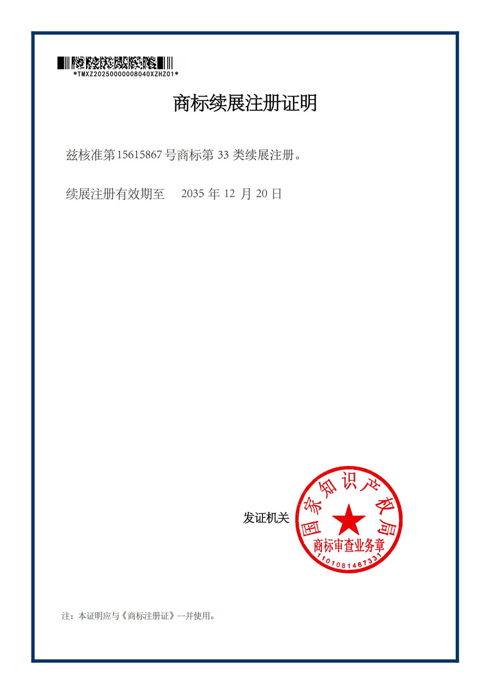

# 商标注册证 / 续展证明生成技能

给一个 8 位商标注册号，自动从官方公示库反查要素，套模板出图。

| 注册证 | 续展证明 |
|---|---|
|  |  |

两套版式共用一套渲染引擎和字体，输出的 PDF417、二维码可被扫码枪/手机正常识别。

---

## 能做什么

| 能力 | 说明 |
|---|---|
| 一号出图 | `python tools\cert_from_regno.py 42500948` 一条命令出注册证 |
| 自动分派 | 查号时先看名下有没有续展记录：有就出续展证明，没有就出注册证 |
| 全要素还原 | PDF417、小字编码、二维码、商标图样、商品项目、注册人/地址、两个日期 |
| 版式精确 | 字段坐标、字号、字距、字重、横向压缩比都从实物票面标定，不是目测 |
| 防错校验 | 注册日期须在签发局长任期内，续展证明须在版式适用期内，越界直接报错 |
| 批量调用 | 支持 `--json` 喂已知字段（跳过网络）、`--quiet` 只吐路径，方便插件集成 |

## 快速开始

```bash
# 1. 装 Python 依赖
pip install pillow numpy pdf417gen qrcode zxing-cpp

# 2. 装字体（关键，缺了数字字形会变宽变粗）
copy assets\fonts\AdobeSongStd-Light.otf C:\Windows\Fonts\

# 3. 跑一个号
python tools\cert_from_regno.py 42500948
```

看到 `[4/4] 输出 ...` 就成功了，图在 `assets/cert/out_42500948.jpg`。

验证续展：

```bash
python tools\cert_from_regno.py 15615867 --renewal
```

> 需要 **Node.js 22+**（脚本用内置 `fetch`/`WebSocket`，无 npm 依赖）和 **Edge**（Windows 自带）。抓取走无头 Edge + CDP，因为数据源有瑞数 WAF，纯 HTTP 请求会被挡。

## 命令

```bash
# 自动分派（有续展记录出续展，否则出注册证）
python tools\cert_from_regno.py 15615867

# 强制续展（名下没有续展记录会报错，不降级）
python tools\cert_from_regno.py 15615867 --renewal

# 指定输出路径 + 只吐路径（给插件用）
python tools\cert_from_regno.py 15615867 --out D:\tmp\a.jpg --quiet

# 用已抓好的字段直接出图（跳过网络）
python tools\cert_from_regno.py 15615867 --json cert\某号.json

# 调整商标图样大小（1.0 = 原始图样尺寸）
python tools\cert_from_regno.py 63724439 --logo-scale 1.5
```

退出码：`0` 成功，`2` 失败（stderr 里是 `ERROR: ...`）。

## 工作原理

```
8 位注册号
   │
   ├─ 旧库 wsgs.sbj.cnipa.gov.cn ──→ rows（可能同时有注册证 + 续展证明）
   │       └─ CDP 驱动无头 Edge 过瑞数 WAF
   │
   ├─ 新门户 pub.sbj.cnipa.gov.cn ──→ 旧库没记录时枚举 barCode 兜底
   │
   ├─ 分派：有 XZHZ 记录 → 续展证明版式
   │        否则        → 注册证版式
   │
   └─ 渲染引擎（配置驱动）
          擦除原字段 → 按标定的字号/字距/压缩比重绘 → 重画 PDF417/二维码 → 输出 JPG
```

编码规则：

| 版式 | 条码串 | 小字 |
|---|---|---|
| 注册证 | `B{版式码}TMZC{注册号左补零到12位}ZCZC01000{序号}` | `*TMZC{注册号}D01T{printDate YYMMDD}*` |
| 续展证明 | `B1021TMXZ{15位申请号}XZHZ01{序号}` | `*TMXZ{15位申请号}XZHZ01*` |

## 目录结构

```
tools/
  cert_gen.py           渲染引擎（配置驱动，读 JSON 画图）
  cert_from_regno.py    ★ 主入口：查号 → 取要素 → 出图
  cdp_probe.js          旧库抓取（CDP 驱动 Edge，过瑞数 WAF）
  cdp_pub.js            新门户枚举（同上）
  qq_server.py          [可选] NapCat OneBot11 接入
  autostart.ps1         [可选] 开机自启 Edge + 服务
  backup_pack.py        打包脚本

cert/
  42500948.json         注册证版式配置（字段坐标、字体、字号）
  ext_template.json     续展证明版式配置
  SKILL.md              方法论（坐标怎么量、字重怎么标定）
  REQUEST_TEMPLATE.md   需求模板（要用户提供什么）

assets/
  cert/template.jpg     注册证空白模板 1280×1831
  cert/ext/template.jpg 续展证明空白模板 1586×2245
  cert/ext/samples/     三张真实续展样本（核对用）
  fonts/                AdobeSongStd-Light.otf（数字字形用）

aurabot/
  trademark-cert/index.mjs   Aurabot 插件模块（/证书、/续展）
```

## 接入 Aurabot

模块在 `aurabot/trademark-cert/`，放进 Aurabot 的 modules 目录即可：

```
/证书 42500948     出注册证（自动分派）
/续展 15615867     强制出续展证明
```

> `workdir` 必须指向解压后的根目录，否则脚本找不到 `assets/cert/template.jpg`。

## 详细部署

换机器、配开机自启、故障排查、环境细节，看 **[DEPLOY.md](DEPLOY.md)**。

## 注意事项

- 生成的证只用于已核实的商标信息核对，不替代官方证书
- 公开库对个人和小微企业会脱敏（`*******`），这类字段需要人工补全，脚本会打 `!!` 提醒
- 签发局长签名固定在模板上，脚本会校验注册日期是否在申长雨任期内（2018-05-01 ~ 2026-10）
- 数据源是公开查询接口，有频率限制；旧库偶发返回空结果（WAF 卡住），重试一次通常就好

## 环境要求

| 项目 | 版本 |
|---|---|
| Python | 3.10+（开发用 3.12） |
| Node.js | 22+ |
| Edge | Windows 自带 |
| 字体 | AdobeSongStd-Light.otf（含在仓库内） |
